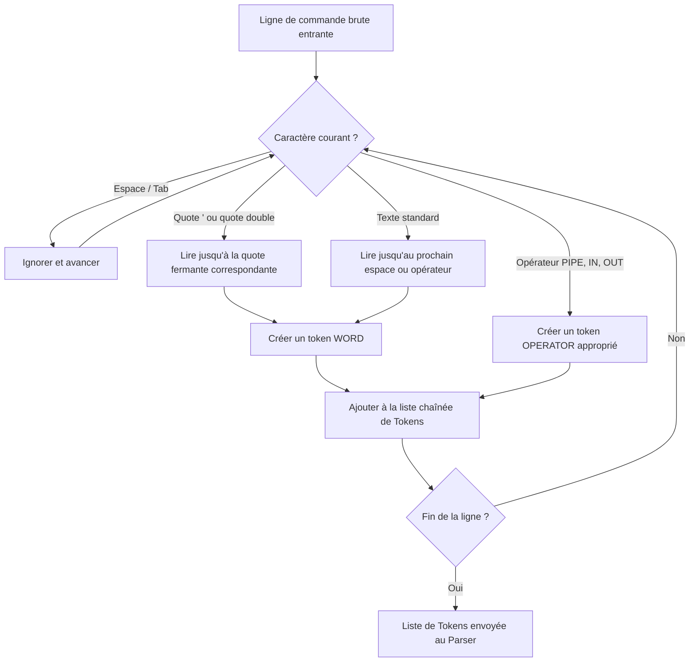
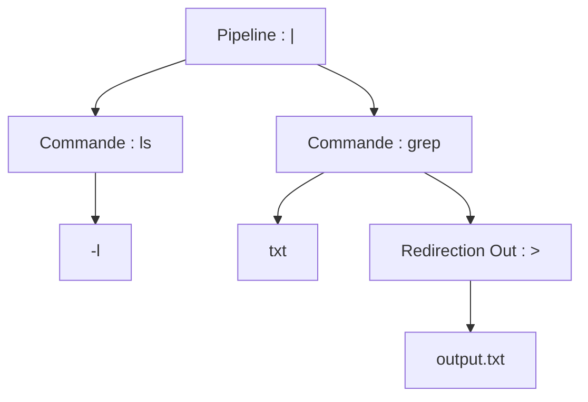
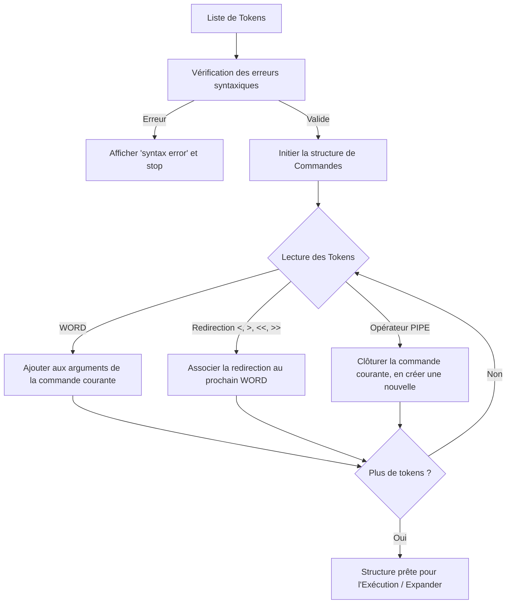
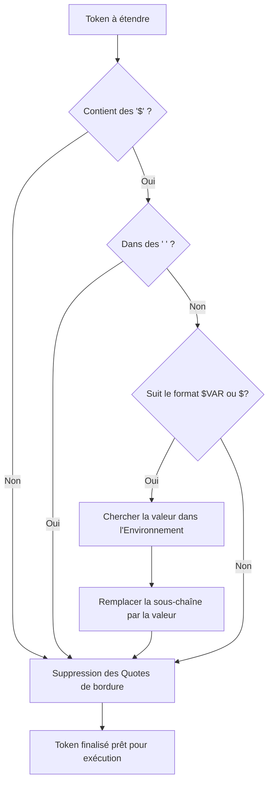
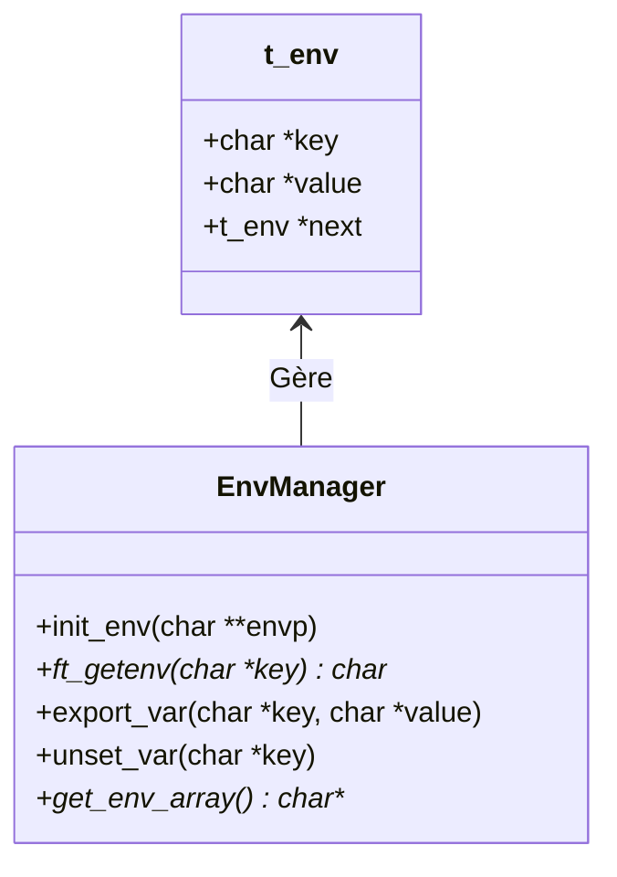
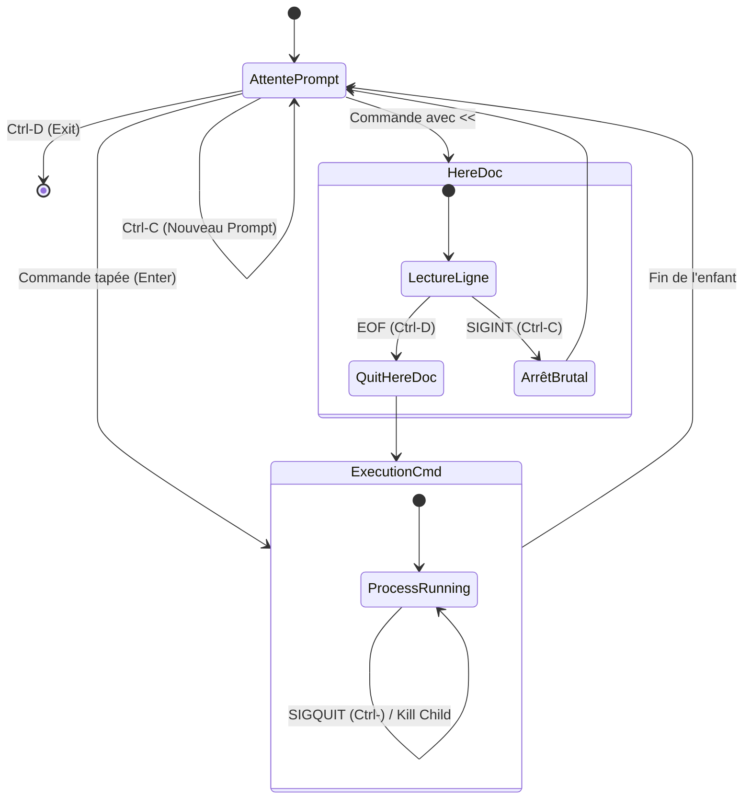

# Guide Syntaxique et Workflows de Minishell

Ce document détaille le fonctionnement interne des différents modules de Minishell : Lexer, Parser, Expander, Environnement et Signaux. Chaque section contient des explications détaillées et des diagrammes de flux (Mermaid) pour illustrer les processus.

---

## 1. Le Lexer (Analyse Lexicale)

Le Lexer est la première étape du traitement de la ligne de commande. Son rôle est de lire la chaîne de caractères brute entrée par l'utilisateur (la *prompt*) et de la découper en une suite d'unités lexicales appelées **Tokens**.

### Types de Tokens courants
- `WORD` : Mots, commandes, arguments (ex: `ls`, `-l`, `fichier.txt`)
- `PIPE` (`|`) : Opérateur de pipeline.
- `REDIR_IN` (`<`) : Redirection d'entrée.
- `REDIR_OUT` (`>`) : Redirection de sortie.
- `DREDIR_OUT` (`>>`) : Redirection de sortie en mode append.
- `HERE_DOC` (`<<`) : Document intégré (Here-document).

### Règles de tokenisation
1. **Séparateurs** : Les espaces et tabulations séparent les tokens (sauf s'ils sont entre guillemets).
2. **Citations (Quotes)** : 
   - Simple quote (`'`) : Tout ce qui est à l'intérieur est traité comme un seul `WORD`. Aucune interprétation.
   - Double quote (`"`) : Traité comme un seul `WORD`, mais laisse la possibilité à l'Expander d'interpréter les `$`.
3. **Opérateurs** : Les métacaractères (`|`, `<`, `>`) forment leurs propres tokens, même s'ils ne sont pas entourés d'espaces.

### Workflow du Lexer

---

## 2. Le Parser (Analyse Syntaxique)

Le Parser prend la liste de tokens générée par le Lexer et vérifie sa validité syntaxique (ex: on ne peut pas avoir deux pipes consécutifs `| |`). Il construit ensuite un **Abstract Syntax Tree (AST)** (Arbre Syntaxique Abstrait) ou une liste chaînée de **Commandes**.

### Rôles du Parser
1. **Validation** : Rejeter les erreurs de syntaxe (ex: `> >`, ou un `|` seul).
2. **Regroupement** : Rassembler les redirections et les mots dans des structures logiques (les noeuds de l'arbre ou de la liste de commandes).

### Arbre Syntaxique Abstrait (AST)
Dans un shell classique avec des pipelines, la structure la plus simple est souvent une liste chaînée de `t_cmd`, chaque commande contenant ses arguments et ses redirections.

Example pour `ls -l | grep "txt" > output.txt` :

### Workflow du Parser

---

## 3. L'Expander

Avant (ou juste après) la phase de parsing, ou juste avant l'exécution, l'Expander a pour mission de transformer certains tokens selon des règles spécifiques.

### Rôles de l'Expander
1. **Expansion des variables d'environnement** : Remplacer `$VAR` par sa valeur. Si `$VAR` n'existe pas, elle est remplacée par une chaîne vide.
2. **Expansion du statut de sortie** : Remplacer `$?` par le code de retour de la dernière commande.
3. **Suppression des Quotes** : Retirer les `'` et `"` qui entouraient les arguments avant de passer les arguments à `execve`.

### Fonctionnement avec les Quotes
- **Sans quote** : `$VAR` est étendue. Si elle contient des espaces, cela peut parfois créer plusieurs arguments (Word Splitting, selon le sujet 42).
- **Double quote (`"`)** : `"$VAR"` est étendue, mais même s'il y a des espaces, cela reste **un seul argument**.
- **Simple quote (`'`)** : `'$VAR'` n'est **pas** étendue. Le texte reste tel quel.

### Workflow de l'Expander

---

## 4. L'Environnement

L'environnement (souvent stocké sous forme de liste chaînée personnalisée pour un accès facile) contient les variables système passées au programme via le paramètre `envp` du `main`.

### Structure typique de l'environnement (Liste chaînée)
Chaque nœud contient :
- `KEY` : Le nom de la variable (ex: `USER`, `PATH`).
- `VALUE` : Le contenu de la variable (ex: `chapoux`, `/usr/bin:/bin`).

### Rôles du sous-système Environnement
1. **Initialisation** : Analyser `envp` pour peupler la liste chaînée interne au démarrage de Minishell.
2. **Accès** : Fournir la valeur d'une variable pour l'Expander (via une fonction `ft_getenv`).
3. **Modification** : Les builtins `export` et `unset` modifient cette structure.
4. **Génération** : Reformater la liste chaînée vers un tableau `char **` pour le passer à `execve`.

### Gestion de l'Environnement

---

## 5. Les Signaux

La gestion des signaux dans Minishell est cruciale pour répliquer le comportement de `bash`. Les signaux principaux à gérer sont `SIGINT` (Ctrl-C), `SIGQUIT` (Ctrl-\), et à part `EOF` (Ctrl-D, qui n'est pas un signal mais une fin de lecture).

### Comportement attendu (selon l'état du shell)

1. **Mode Interactif (Prompt en attente)**
   - `Ctrl-C` : Affiche un nouveau prompt sur une nouvelle ligne. Le curseur passe en bas. Code de retour (`$?`) mis à 130.
   - `Ctrl-\` : Ignoré, ne fait rien.
   - `Ctrl-D` : Quitte Minishell proprement (comme la commande `exit`).

2. **Lors de l'exécution d'un processus fils (ex: `cat` qui attend, ou commande longue)**
   - `Ctrl-C` : Le signal est envoyé au processus fils. Le shell parent attend, puis passe à une nouvelle ligne. Code de retour = 130.
   - `Ctrl-\` : Le signal est envoyé au processus fils. Affiche "Quit (core dumped)". Code de retour = 131.
   - `Ctrl-D` : Envoyé au processus bloquant, clôt le flux d'entrée.

3. **Lors d'un Here-document (`<<`)**
   - `Ctrl-C` : Interrompt la saisie du here-doc, retourne au prompt principal.
   - `Ctrl-D` : Ferme le here-doc prématurément et continue l'exécution. Affiche un warning spécifique indiquant la ligne exacte où le EOF inattendu a été rencontré.
   - `Ctrl-\` : Ignoré.

### Diagramme d'états des Signaux

