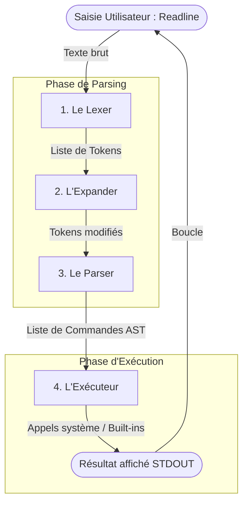
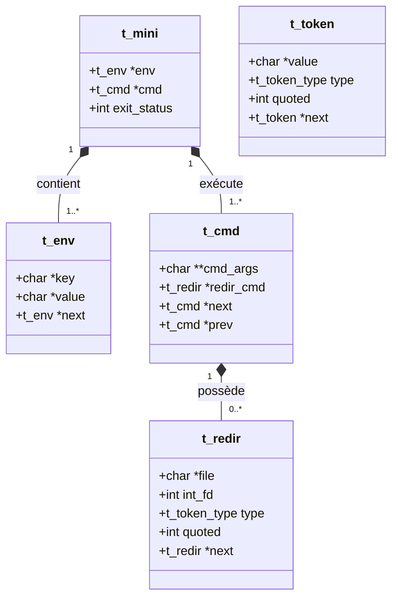
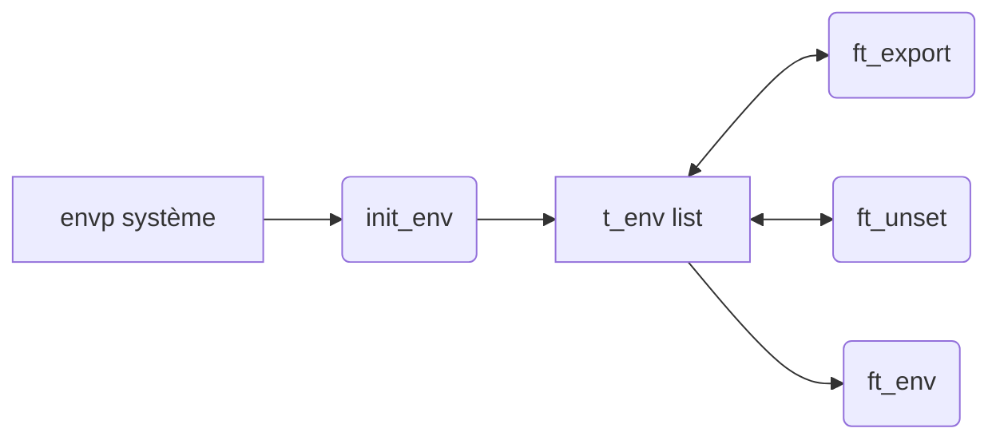
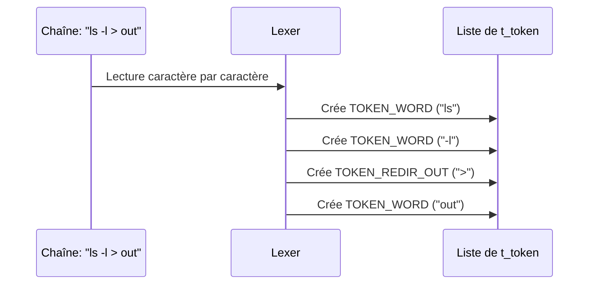
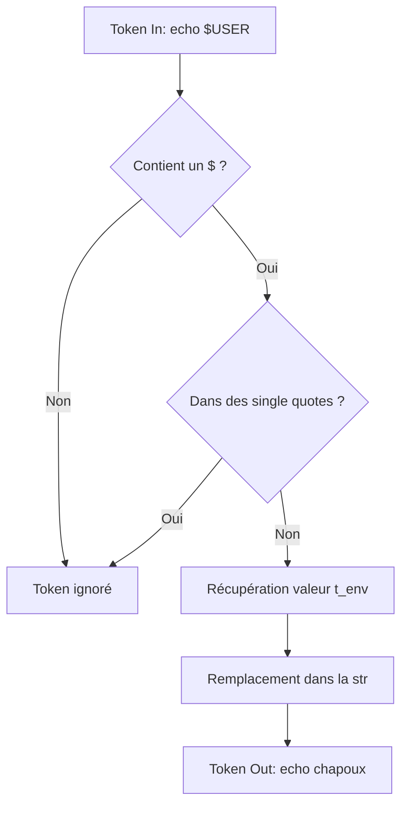
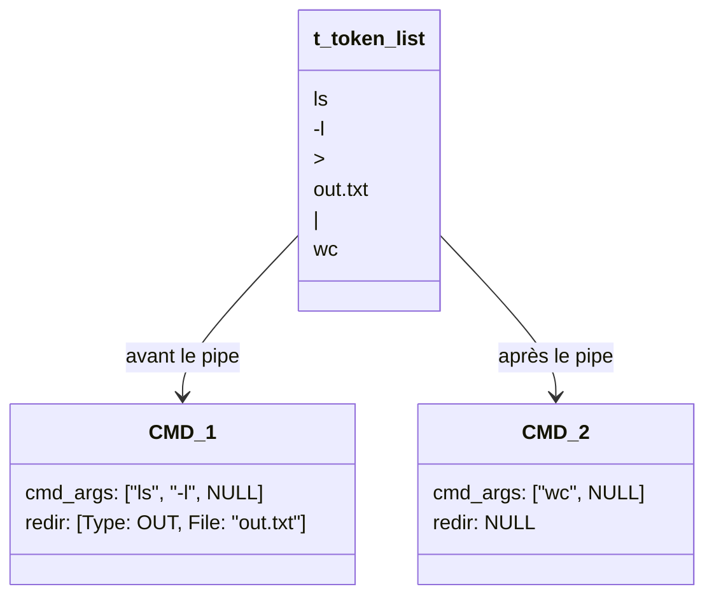
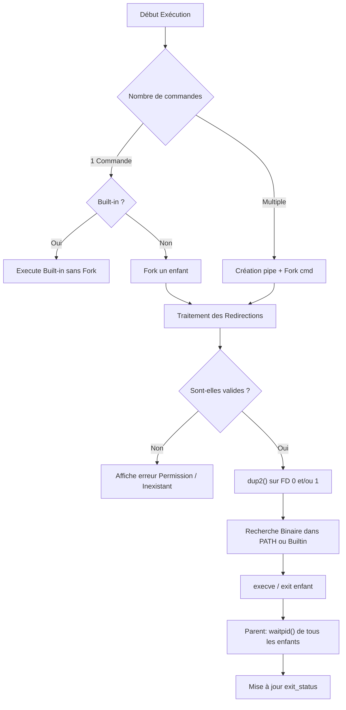
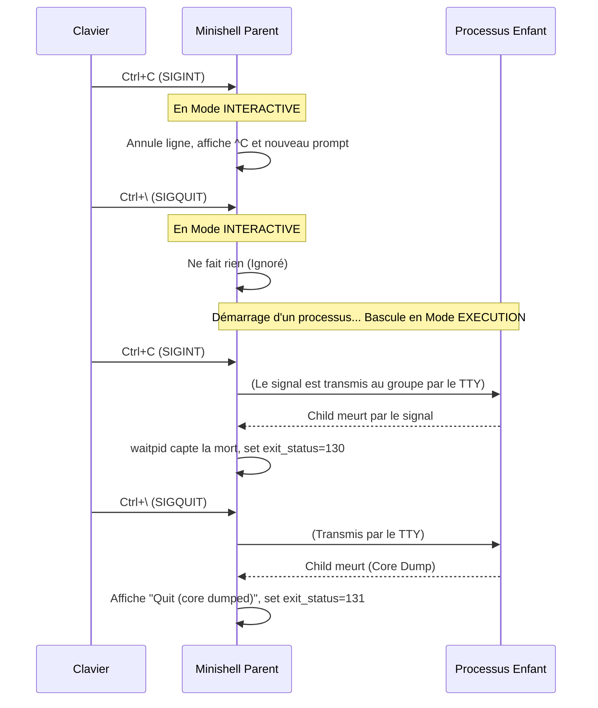

# Guide Technique Approfondi : Minishell

Ce document est une référence technique exhaustive pour le projet **Minishell**. Son objectif est de donner à tous les membres du groupe une vision complète et transparente du fonctionnement interne du programme, des structures de données, et de la logique de chaque module. Ainsi, chaque membre peut comprendre l'intégralité du projet sans avoir à lire ligne par ligne le code des autres.

---

## 1. Architecture Globale et Workflow des Données

Le parseur d'un shell fonctionne comme un compilateur : il prend du texte brut en entrée et le transforme progressivement en structures de données exécutables.

### Diagramme de Flux de Données (Data Flow)

### Explication des étapes pas-à-pas :
1. **La Saisie** : Readline récupère une string comme `echo "hello $USER" > file.txt | cat`.
2. **Lexer** : Découpe la string en petits blocs logiques appelés **Tokens**. Il ne comprend pas le sens de la commande, il identifie juste : mot, espace, pipe, redirection.
3. **Expander** : Scanne les Tokens de type "mot". S'il y trouve un `$`, il vérifie s'il doit le remplacer par une variable d'environnement, sauf si le mot est protégé par des single quotes `' '`.
4. **Parser** : Transforme la liste plate de Tokens en une structure hiérarchique regroupée par commandes (séparées par les pipes `|`). Il sépare les arguments de la commande de ses redirections.
5. **L'Exécuteur** : Fait les appels systèmes (`pipe`, `fork`, `dup2`, `execve`). Il connecte les entrées/sorties et lance les vrais programmes.

---

## 2. Modèle de Données (Les Structures)

Voici comment les données sont réellement stockées en C (définies dans `include/minishell.h`).

### Graphique des Relations (UML)

### Le Contexte Global : `t_mini`
Il est instancié une seule fois dans le `main` et passé par adresse à quasiment toutes les fonctions. Il evite d'utiliser des variables globales (interdit sauf pour les signaux).
- `env` : La version liste chaînée de notre environnement.
- `cmd` : La liste des commandes tapées par l'utilisateur (doublement chaînée).
- `exit_status` : Sauvegarde le code de retour de la dernière commande exécutée pour que `$?` puisse fonctionner.

---

## 3. Détail des Modules (Dossier par Dossier)

Chaque partie de notre Minishell est isolée dans son propre dossier pour garantir la séparation des préoccupations. Voici une plongée profonde dans la mécanique de chaque bout de code.

### A. L'Environnement (`src/environnement/`)
**Objectif** : Manipuler dynamiquement l'environnement au cours de la session. Contrairement à `envp` qui est un tableau statique fourni par le système au lancement, nous devons pouvoir ajouter ou supprimer des variables n'importe quand.

**Comment ça marche en interne :**
1. **Initialisation** : Le shell démarre. On prend `char **envp`, on boucle sur chaque ligne (ex: `PATH=/bin:/usr/bin`) et on la coupe en deux : la clé (`key="PATH"`) et la valeur (`value="/bin:/usr/bin"`).
2. **Built-ins** :
   - `export VAR=val` : Recherche si "VAR" existe avec `find_env_node`. Si oui, sa `value` est `free` puis mise à jour avec `ft_strdup("val")`. Si non, un nouveau maillon `t_env` est créé avec `new_env_node` et chaîné à la fin.
   - `unset VAR` : Parcourt la liste à la recherche de la clé "VAR". Si trouvée, on relie l'élément précédent à l'élément suivant et on `free` la clé, la valeur et le noeud.

### B. Le Lexer (`src/lexer/`)
**Objectif** : Agir comme les "yeux" du shell en transformant une chaîne de caractères en une liste de tokens bruts, sans tenter de les comprendre.

**Logique de traitement :**
- **Séparation** : Les espaces (et tabs) séparent les mots, sauf s'ils sont à l'intérieur de *quotes* (`'` ou `"`). 
- **Quotes** : Un mot peut contenir des quotes fusionnées. Exemple : `ech"o"` est lexé comme un seul `TOKEN_WORD` valant `echo` (les quotes sont ignorées par le lexer lui-même, sauf pour garder le bloc uni).
- **Heredoc** : Lors de la lecture d'un `<<`, le mot d'après est le délimiteur. Si ce délimiteur est entouré de quotes (ex: `<<"EOF"`), l'attribut `quoted` du token est passé à `1`. Le Parser s'en servira.

### C. L'Expander (`src/expander/`)
**Objectif** : Interpréter les variables d'environnement (`$VAR`), les codes de retour (`$?`) et le home (`~`) directement à l'intérieur des tokens avant de créer l'arbre syntaxique.

**Comportements spécifiques :**
- **Série de variables** : Une chaîne peut contenir plusieurs variables collées : `"$USER$PWD"`.
- **Statut d'erreur (`$?`)** : Le `mini->exit_status` est transformé en chaîne via `ft_itoa` et inséré à la place de `$?`.
- **Variable non trouvée** : Si `$INEXISTANTE` est tapé, elle est remplacée par une chaîne vide `""`. S'il n'y a rien d'autre dans le mot, le mot entier disparaît (il devra être ignoré par le parser).

### D. Le Parser (`src/parser/`)
**Objectif** : Grouper les tokens par Commandes (`t_cmd`) et séparer les paramètres de programme des règles de requêtes de fichiers (Redirections). L'Exécution n'a plus rien à filtrer après le passage du Parser.

**Algorithme :**
1. **Contrôle de conformité** : La fonction `check_syntax` s'assure qu'un pipe `|` ou une redirection `>` ne pendent pas à la fin du vide, ou qu'ils ne se suivent pas bizarrement (ex: `> |`).
2. **Construction** : Iteration sur la liste de `t_token`. 
   - Si c'est un `TOKEN_WORD`, il est ajouté au tableau `cmd_args` de la commande actuelle.
   - Si c'est un opérateur de redirection, le token opérateur ET le token de mot suivant (le fichier cible) sont extraits et mis dans la structure `t_redir` rattachée à la commande.
   - Si c'est un `TOKEN_PIPE`, on ferme la `t_cmd` actuelle, et on initialise la `t_cmd` suivante via le maillon `next`.

### E. L'Exécution (`src/execution/`)
**Objectif** : Interagir avec l'Operating System. Lancer des fork, jouer avec des pipes, ouvrir les fichiers, diriger correctement les flux avec dup2 et finalement exécuter la commande ou le built-in.

**Détails Techniques par étape :**
- **Les Pipes** : Entre la `cmd1` et la `cmd2`, l'exécuteur appelle `pipe(fd_pipe)`. Le `fd_pipe[1]` (écriture) devient la sortie standard (`STDOUT`) du parent `cmd1`. Le `fd_pipe[0]` (lecture) devient l'entrée standard (`STDIN`) de `cmd2`.
- **Les Redirections `>` et `<`** : Sont exécutées *après* les pipes. Si on a `cmd1 > file.txt | cmd2`, le pipe vers `cmd2` est créé, mais ensuite `cmd1` écrase ce pipe pour pointer `STDOUT` vers `file.txt`.
- **Heredoc (`<<`)** : 
  - S'ouvre dans un contexte prioritaire avant d'exécuter la ligne. 
  - Lit `readline` avec un prompt `>` spécial.
  - Si le mot délimiteur était en *quotes* (`quoted=1` dans Parser), l'Expander ne visite pas le Heredoc. Sinon, les `$VAR` tapées dans le prompt du heredoc sont remplacées.
- **Récupération du statut** : Une fois la chaîne de forks terminée, le processus racine Minishell bloque avec `waitpid()`. Il analyse le `status` retourné par le système (`WIFEXITED` ou `WIFSIGNALED`) pour affecter la bonne valeur `0-255` à `mini->exit_status`.

### F. La Gestion des Signaux (`src/signal/`)
**Objectif** : Répliquer le comportement complexe de Bash face aux touches d'interruption `Ctrl+C` (`SIGINT`) et `Ctrl+\` (`SIGQUIT`).

**Implémentation avec `t_signal_mode` :**
La console TTY envoie les signaux à *tous* les processus du groupe (le Minishell ET ses processus fils bashés via fork). Le rôle de notre code est donc souvent de décider "Comment notre parent Minishell réagit-il ?"

La fonction magique `set_signal_mode(t_signal_mode mode)` va paramétrer nos gestionnaires d'évènements `sigaction` avant ou après chaque phase :

1. `SIG_MODE_INTERACTIVE` : 
   - État classique dans l'attente d'une commande de l'utilisateur.
   - **SIGINT (`Ctrl+C`)** : La fonction handler s'active, fait un `write(1, "\n", 1)`, prévient Readline d'effacer l'écran en cours via `rl_on_new_line()` puis `rl_replace_line("", 0)`, et redemande l'affichage avec `rl_redisplay()`. Le `$?` est forcé à 130 (comportement bash).
   - **SIGQUIT (`Ctrl+\`)** : Le signal est explicitement ignoré (`SIG_IGN`).

2. `SIG_MODE_EXECUTION` : 
   - Pendant qu'un programme externe est en cours d'exécution via le `fork`. Notre `read` clavier est bloqué par `waitpid`.
   - **SIGINT et SIGQUIT** : Le processus *père* Minishell ne doit **surtout pas** intercepter le signal, car il mourrait lui-même ! Donc le père ignore les deux (`SIG_IGN`). Le shell enfant (`execve`) recevra lui le signal natif de l'OS et mourra s'il le décide, et le père s'en rendra compte via le statut de `waitpid()`.

3. `SIG_MODE_HEREDOC` : 
   - Une sous-boucle `readline()` s'ouvre pour écrire le heredoc temporaire.
   - **SIGINT (`Ctrl+C`)** : Si on fait l'erreur d'utiliser le mode "INTERACTIVE" normal ici, le prompt rouvre et le heredoc ne se ferme jamais vraiment "proprement". Le handler de ce mode signale simplement dans une globale (`g_signal_received = SIGINT`) que l'utilisateur a coupé le programme, force la fermeture proprement du pipe virtuel et retourne immédiatement aux boucles principales. Ce signal fait échouer discrètement la commande prévue pour le heredoc.

---

## 4. Consignes Techniques et Conventions d'Équipe

*   **Libération de Mémoire (Garbage Collection)** :
    *   Les `tokens` sont supprimés et libérés dès que le parsing vers `t_cmd` est fini.
    *   Les listes `t_cmd` (et les `t_redir` internes) sont freeées à la toute fin de l'exécution d'une ligne, juste avant de réafficher le prompt (`free_cmd()`).
*   **Protection des Appels Systèmes** : Chaque fois qu'on fait un `malloc()`, un `open()`, un `pipe()` ou un `fork()`, le code source *doit* vérifier que le retour n'est pas -1 (ou NULL). Si c'est le cas, affichez une erreur avec `perror()` ou un `ft_putstr_fd` dans `STDERR` (2), et quittez proprement ce qui est en cours sans segfault.
*   **Pas de test unitaires dans les PRs** : Tout ce qui se trouve dans `tester/` est purement pour la vérification CI locale. Ces dossiers n'impactent pas l'architecture du binaire ou de ses sources internes.

---

## 5. Les Codes d'Erreurs Standards (Exit Status) / Astuces pour `$?`

Afin de passer les tests de validation profonds (notamment les testeurs automatiques), Minishell DOIT respecter parfaitement les codes de retour POSIX stockés dans `$?`. 
Voici la liste de référence indispensable pour votre développement :

*   `0` : **Succès**. La commande s'est déroulée sans accroc.
*   `1` : **Erreur générale**. Erreurs mineures, arguments invalides ou échec non-spécifique (ex: `cd /inexistant` ou redérection `>` sur un dossier).
*   `2` : **Erreur de syntaxe (Parsing) ou Argument invalide**. Un token inattendu, ou lors de l'utilisation d'un argument non numérique sur le built-in `exit` (ex: `exit abc`), provoquant "numeric argument required" et la fermeture du shell.
*   `126` : **Permission refusée ou Non-exécutable**. Le fichier cible existe, mais n'a pas les droits `+x` (Permission denied) ou bien est explicitement un dossier (`Is a directory`). 
*   `127` : **Command not found**. L'exécutable n'a pas été trouvé (ni dans le `PATH`, ni en nom absolu/relatif).
*   `128 + Signal` : **Processus tué par signal**. Lorsqu'un processus meurt à cause d'un signal système `n`.
    *   `130` (128 + 2) : Tué par un interruption clavier `SIGINT` (Ctrl+C).
    *   `131` (128 + 3) : Tué par un quit `SIGQUIT` (Ctrl+\), généralement accompagné du message "Quit (core dumped)".
*   `255` : **Exit status hors limites (exemple)**. L'exit status est un octet (0-255). Un code négatif comme `exit -1` bouclera via le modulo sur `255`.

### 💡 Gestion des fuites mémoires en fin de process
Lorsque vous utilisez `exit` (built-in ou fin du main), assurez-vous d'avoir une fonction `free_all_and_exit(mini, code)` bien gérée qui libérera l'environnement global, les buffers en attente et les structures `t_cmd` persistantes avant de terminer pour maintenir le binaire Valgrind-proof.