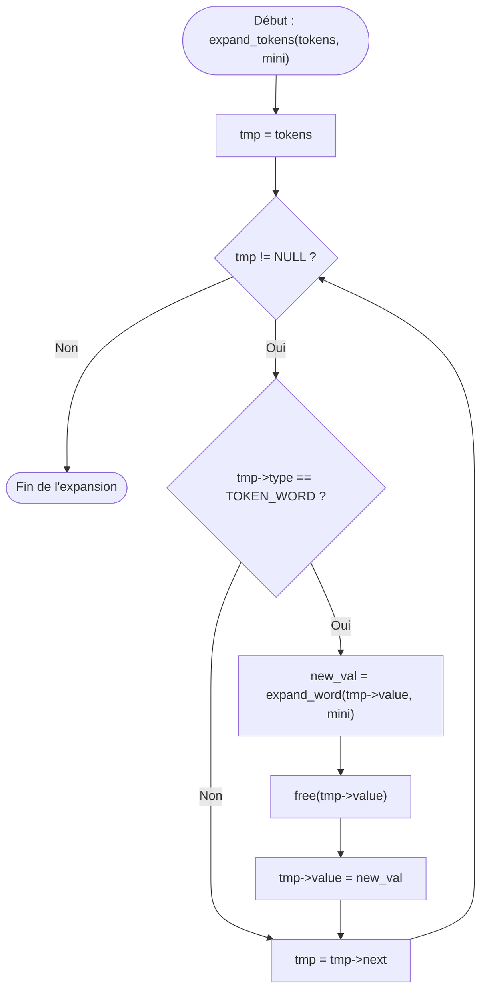
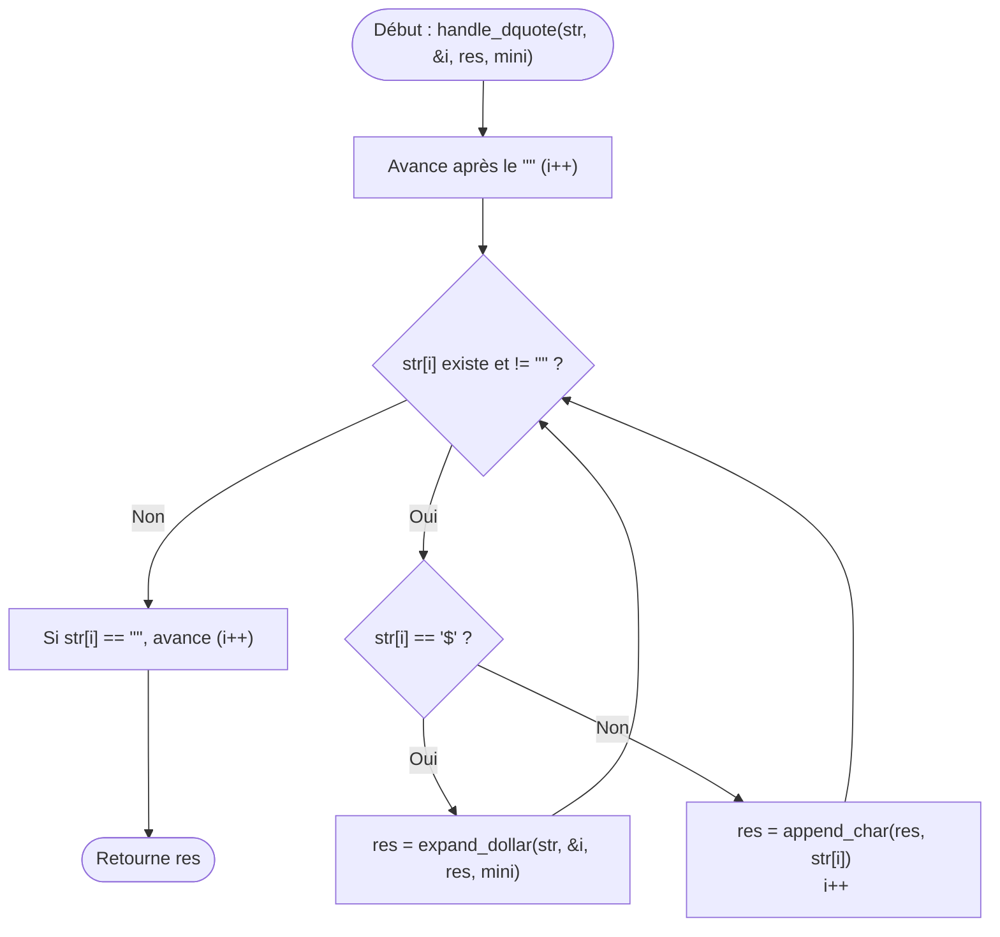
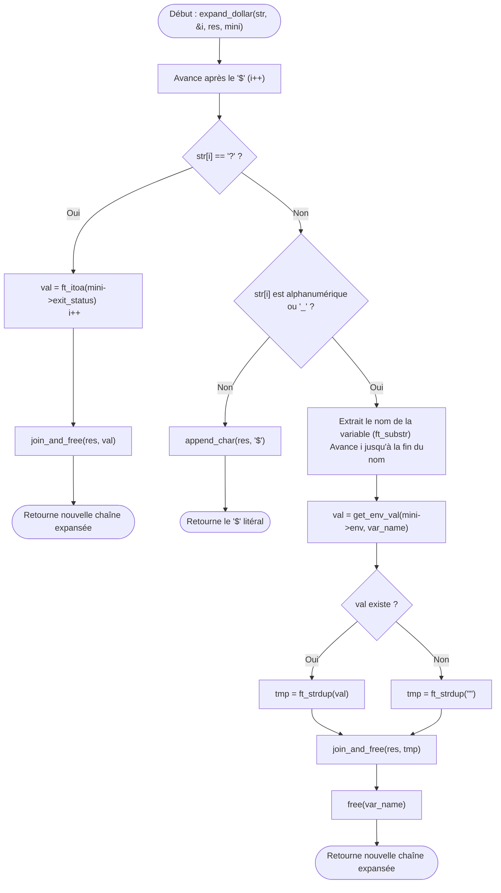

# Expander Flowchart

Ce document détaille le fonctionnement de l'expander du minishell. L'expander est chargé de parcourir les tokens générés par le lexer pour remplacer les variables d'environnement (`$VAR` ou `$?`) par leur valeur, et de gérer la suppression ou l'interprétation des guillemets (quotes simples `'` et doubles `"`).

## 1. Boucle principale (`expand_tokens`)

L'expander parcourt la liste des tokens via `expand_tokens` et n'applique l'expansion que sur les tokens de type `TOKEN_WORD`.

## 2. Expansion d'un mot (`expand_word`)

La fonction lit le mot caractère par caractère et agit différemment selon le caractère rencontré (guillemets simples, guillemets doubles, ou dollar).

```mermaid
flowchart TD
    StartWord(["Début : expand_word(word, mini)"]) --> InitRes["res = &quot;&quot; <br> i = 0"]
    
    InitRes --> LoopWord{"word[i] != '\0' ?"}
    LoopWord -- Non --> ReturnRes(["Retourne res"])
    
    LoopWord -- Oui --> CheckChar{"Caractère word[i] ?"}
    
    CheckChar -- " '\'' (simple quote) " --> HandleSQuote["Avance manuellement jsq quote fermante, <br> ajoute les caractères bruts dans res sans expanser"]
    HandleSQuote --> LoopWord
    
    CheckChar -- " '&quot;' (double quote) " --> HandleDQuote["res = handle_dquote(word, &i, res, mini)"]
    HandleDQuote --> LoopWord
    
    CheckChar -- " '$' (dollar) " --> HandleDollar["res = expand_dollar(word, &i, res, mini)"]
    HandleDollar --> LoopWord
    
    CheckChar -- " Autre caractère " --> AppendChar["res = append_char(res, word[i++])"]
    AppendChar --> LoopWord
```

## 3. Gestion des Double Quotes (`handle_dquote`)

À l'intérieur des doubles quotes, les variables (`$`) sont expansées, tandis que les autres caractères sont conservés fidèlement.

## 4. Expansion des Variables (`expand_dollar`)

Remplace la variable (ex: `$?` ou `$VAR`) par sa valeur extraite de l'environnement (ou par `""` si elle est introuvable).

