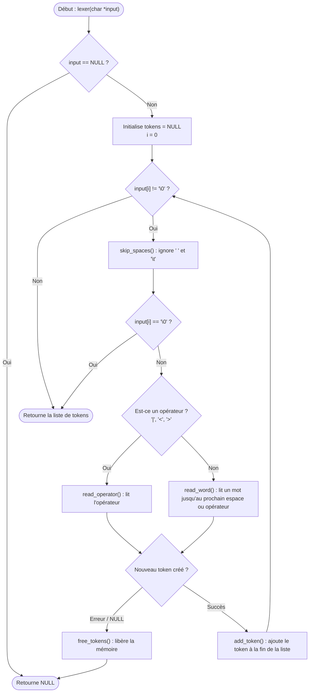
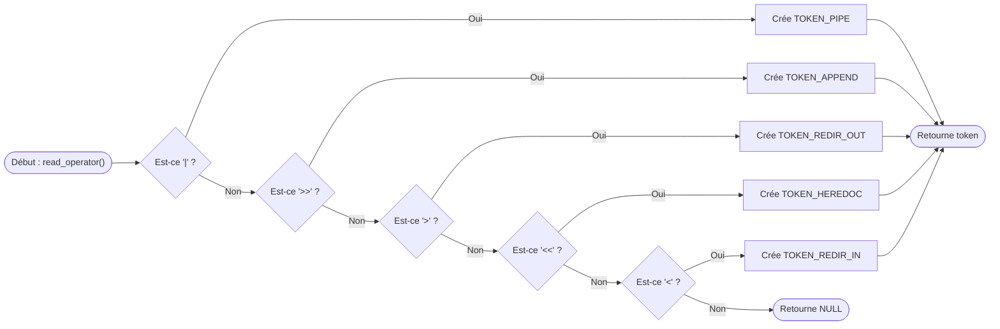

# Lexer Flowchart

Ce document détaille le fonctionnement du lexer du minishell. Le lexer est responsable de la transformation de la chaîne de caractères brute (l'input de l'utilisateur) en une liste structurée de tokens (`t_token`).

## Algorithme principal



## Détail : `read_word`

Cette fonction extrait un mot complet, en gérant le cas où le mot est entre guillemets simples ou doubles.

```mermaid
flowchart TD
    StartWord(["Début : read_word() "]) --> SaveStart["start = i"]
    SaveStart --> LoopWord{"Caractère courant valide ? <br/> Ni espace, ni tab, ni opérateur"}
    
    LoopWord -- Non --> Substr["ft_substr() : extrait la chaîne du token"]
    LoopWord -- Oui --> CheckQuote{"Est-ce une quote ? <br/> '\'' ou '\"'"}
    
    CheckQuote -- Non --> Incri1["i++"]
    CheckQuote -- Oui --> SkipQuotes["Sauvegarde quote, i++, avance i jusqu'à la quote fermante, puis i++"]
    
    Incri1 --> LoopWord
    SkipQuotes --> LoopWord
    
    Substr --> CheckSubstr{"Sous-chaîne OK ?"}
    CheckSubstr -- Non --> ReturnNullWord(["Retourne NULL"])
    CheckSubstr -- Oui --> CreateTokenWord["create_token(value, TOKEN_WORD)"]
    CreateTokenWord --> ReturnWord(["Retourne le token WORD"])
```

## Détail : `read_operator`

Gère la détection des différents tokens spéciaux (`|`, `<`, `>`, `<<`, `>>`).


