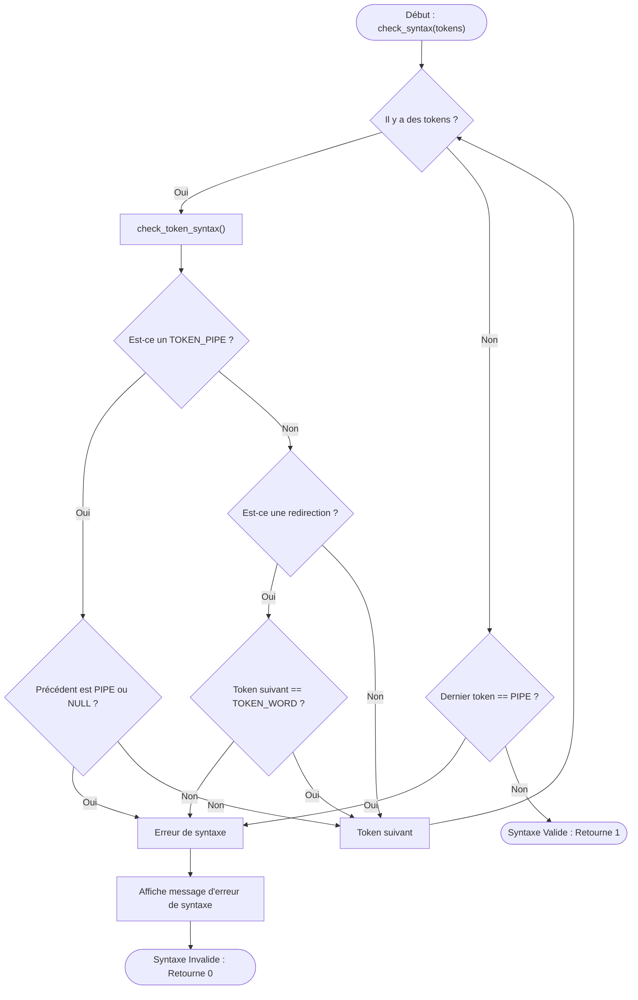
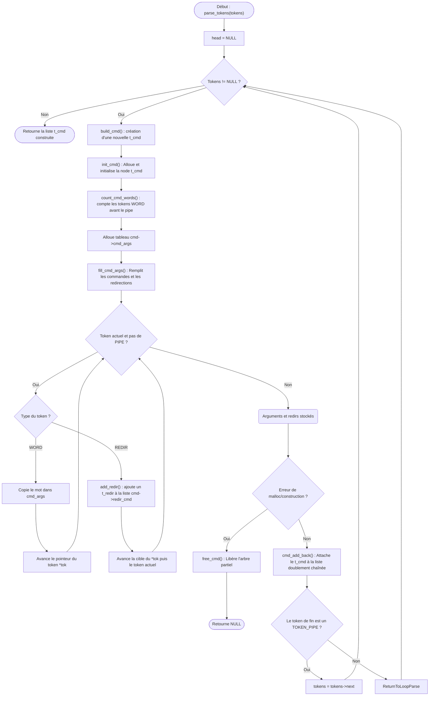

# Parser Flowchart

Ce document détaille le fonctionnement du parser du minishell, qui est chargé de transformer la liste de tokens bruts provenant du lexer en une liste de commandes structurées (`t_cmd`) prêtes pour l'exécution.

## 1. Validation de la syntaxe (`check_syntax`)

Avant de construire les arbres de commandes, le parser s'assure que la suite de tokens est syntaxiquement valide (pas de pipe en début/fin, pas de redirections sans cibles, etc.).

## 2. Construction de la liste des commandes (`parse_tokens`)

Une fois la syntaxe jugée valide, la liste des commandes est générée. Chaque nœud `t_cmd` contiendra une liste d'arguments (`cmd_args`) et une liste de redirections associées (`redir_cmd`).

