# Flowcharts des Fonctions du Parser

Ce document rassemble les flowcharts d'exécution (logique) pour chaque fonction présente dans le dossier `src/parser/` du projet minishell, générés à l'aide de Mermaid.

---

## Fichier `parser.c`

### `count_cmd_words`

Compte le nombre de mots (arguments) d'une commande jusqu'au pipe.
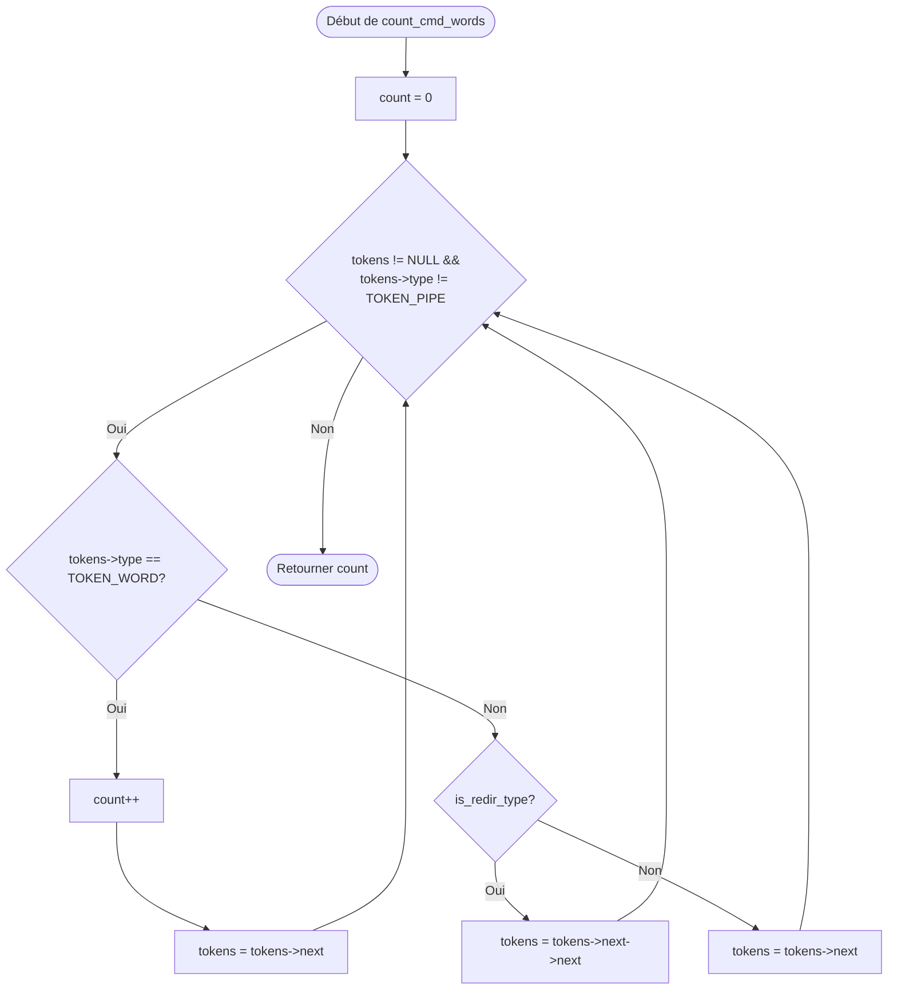

### `redir_add_back`

Ajoute une redirection à la fin de la liste des redirections d'une commande.
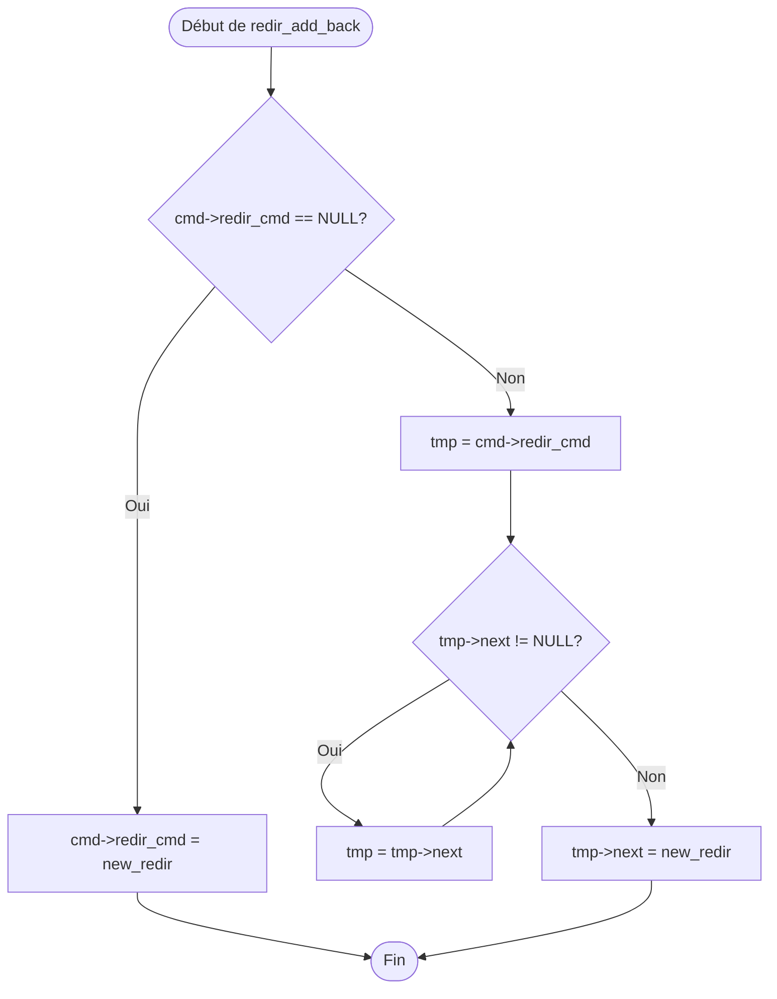

### `add_redir`

Crée et ajoute une nouvelle redirection.
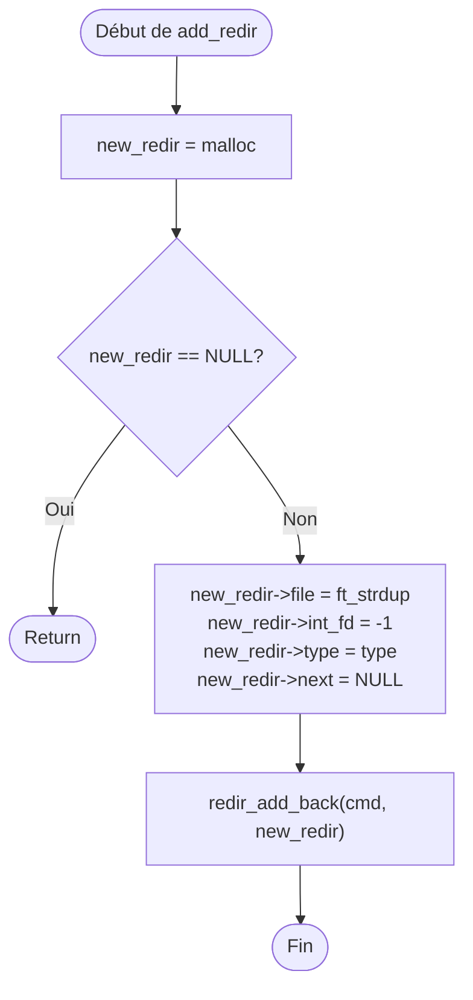

### `init_cmd`

Crée et initialise la structure `t_cmd`.
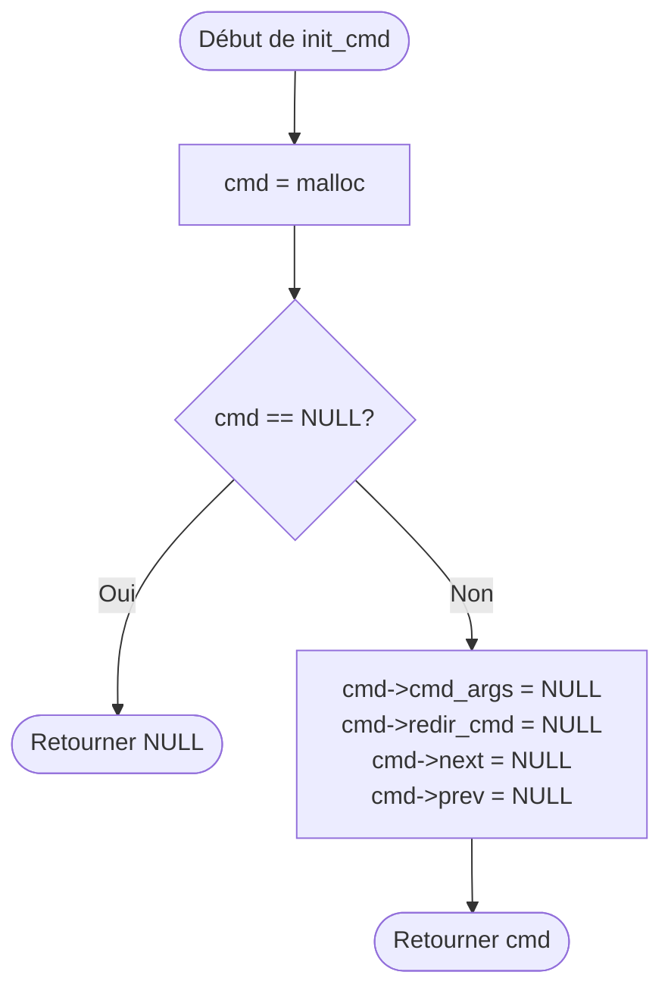

---

## Fichier `parser_build.c`

### `fill_cmd_args`

Remplit le tableau des commandes et leurs redirections depuis les tokens.
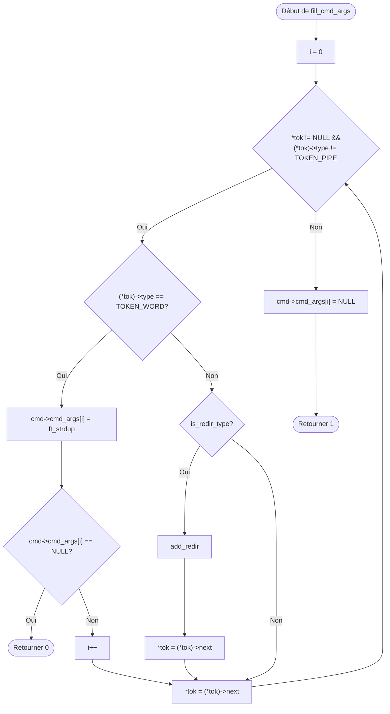

### `build_cmd`

Crée et remplit entièrement une nouvelle de commande `t_cmd`.
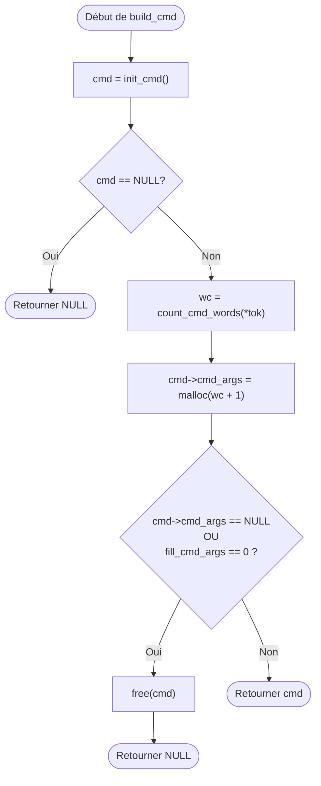

### `cmd_add_back`

Ajoute une commande à la fin de la liste de processus.
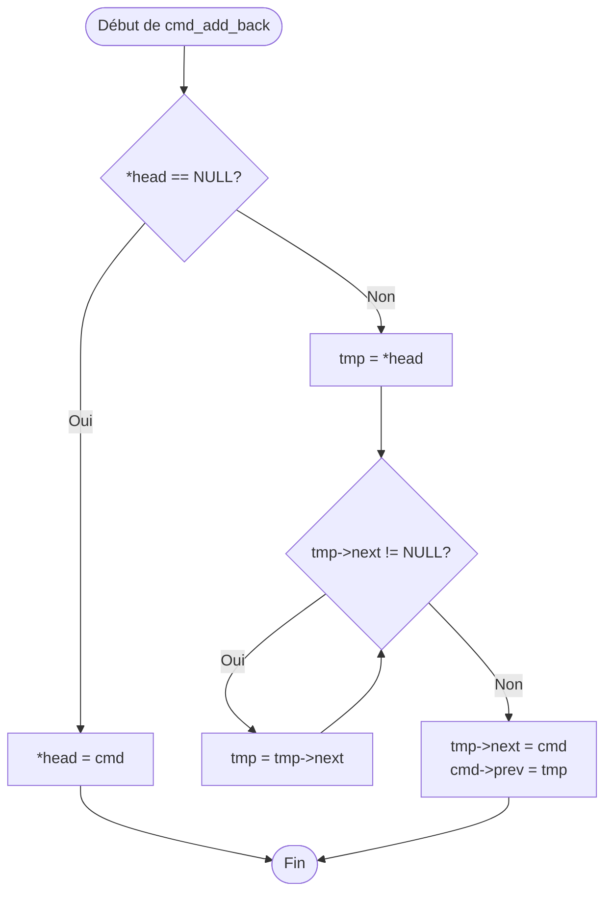

### `parse_tokens`

Fonction principale qui assemble les tokens en structure de commandes chainées.
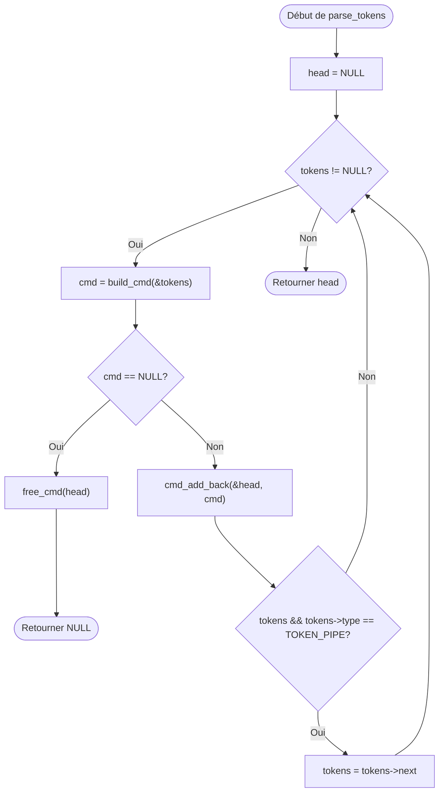

---

## Fichier `parser_syntax.c`

### `print_syntax_error`

Affiche le message d'erreur de syntaxe de parsing.
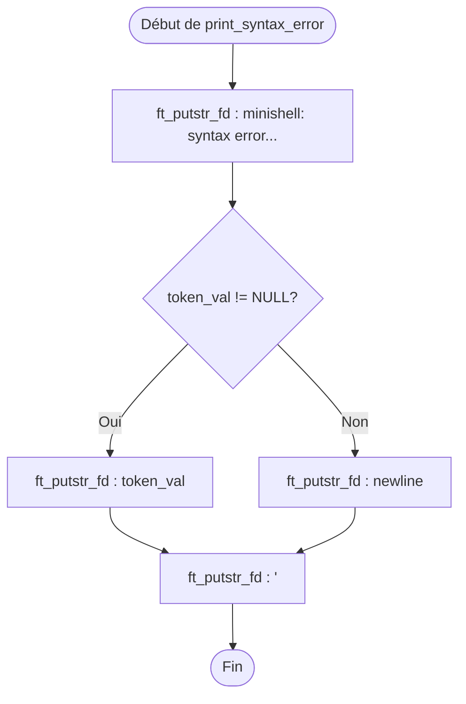

### `is_redir_type`

Vérifie si un token est une redirection.
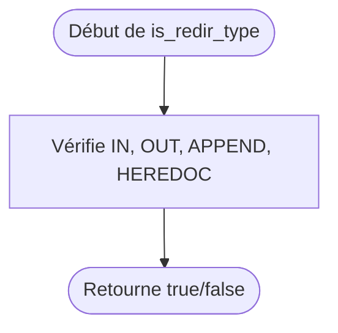

### `handle_redir_error`

Vérifie qu'une redirection est bien suivie d'un argument valide.
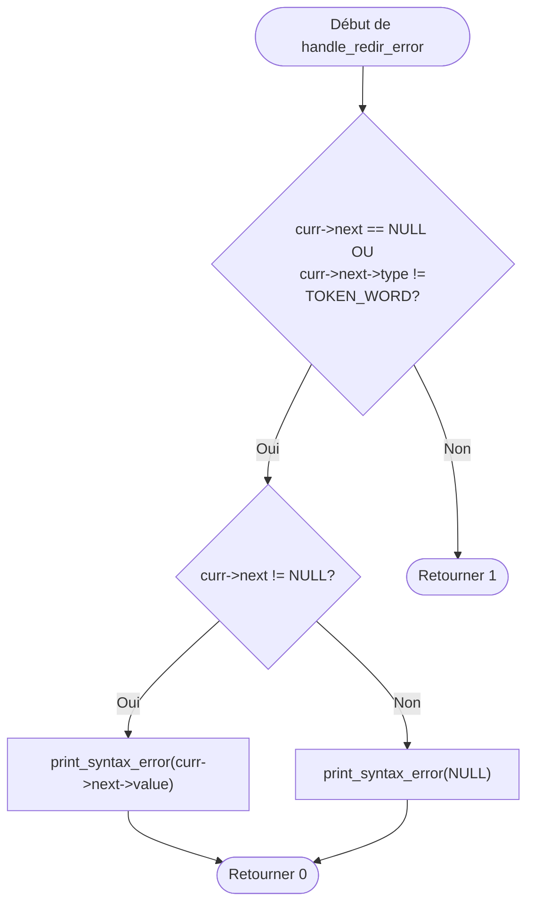

### `check_token_syntax`

Vérifie unitairement la syntaxe avec les conditions locales d'un token.
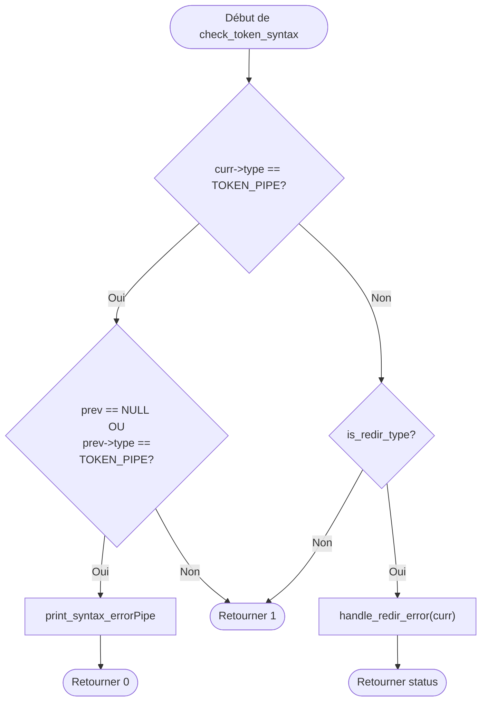

### `check_syntax`

Fonction principale pour s'assurer de la validité d'une liste entière de tokens.
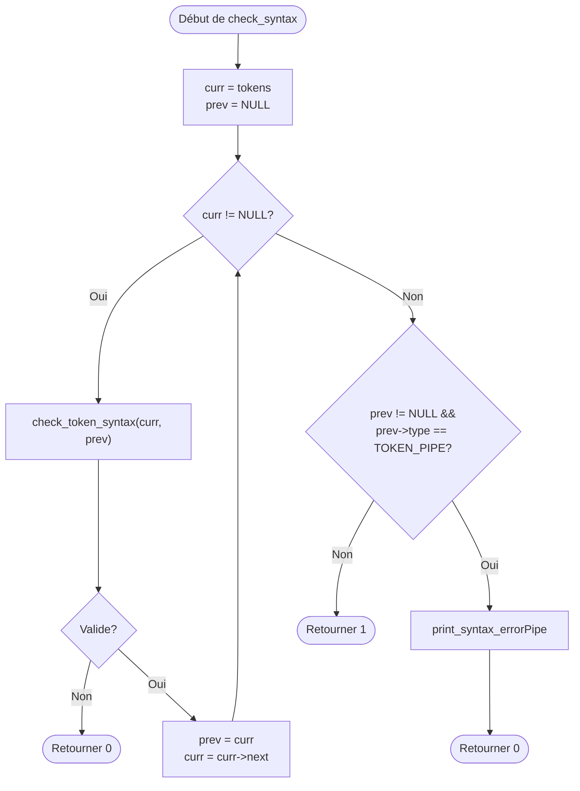

---

## Fichier `parser_free.c`

### `free_cmd_redirs`

Libère les redirections rattachées à une commande.
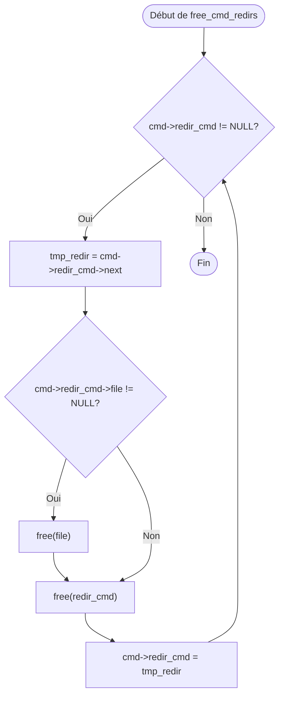

### `free_cmd`

Parcourt des commandes chaînées pour tout libérer.
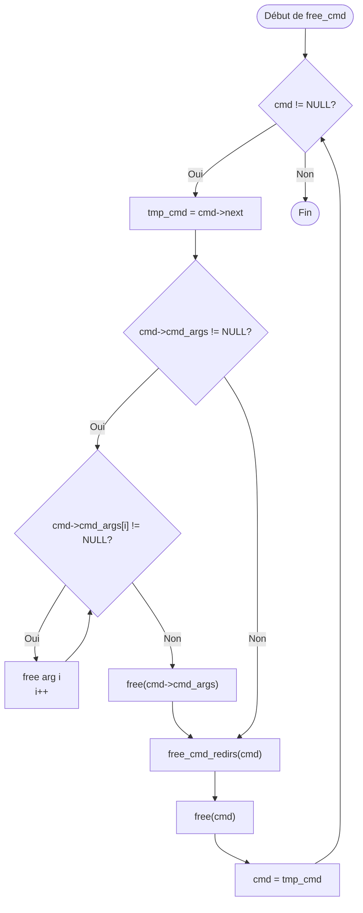